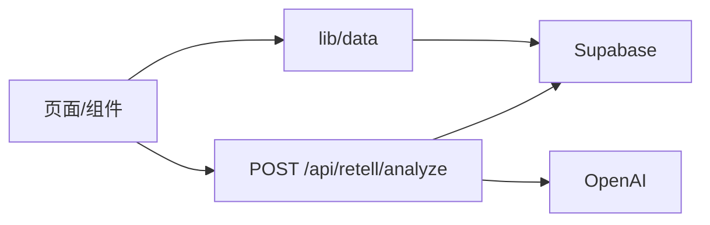

# 开口说英语 · 精听复述练习

一句话：面向“听得懂、开不了口”的成人学习者，用 20 篇精听 + 分段复述 + AI 结构化反馈，练到敢开口。

## 主要功能

- 课程精听：双语段落、起止秒跳转、关键词。
- 分段/整篇复述：浏览器录音、本地预览、明确提交才上传。
- AI 反馈：英文转写 + 内容得分/已覆盖/遗漏/语言建议/自然表达/下一步练习。
- 笔记：按课程/段落新增、编辑、删除，云端或本浏览器持久化。
- 学习进度与历史：节流保存进度，历史展示真实记录。
- 登录：邮箱 magic link/OTP，PKCE confirm 回跳。

## 技术栈与架构

Next.js 16 App Router、TypeScript strict、Tailwind、Supabase（Auth/Database/Storage）、OpenAI（Audio Transcriptions + Responses API）、Vitest。



详见 `docs/ARCHITECTURE.md`。

## 本地运行

```bash
npm install
npm run dev
```

访问 `http://localhost:3000`。

## 演示模式

未设置 Supabase 变量时自动演示：Mock 课程、localStorage 笔记（标注“仅此浏览器”）、`demo-result` 演示反馈均可用。演示入口：首页 → 第 1 篇 → 复述 → 提交（未配置时跳演示结果）。

## Supabase/OpenAI 配置

```env
# .env.local（不提交）
NEXT_PUBLIC_SUPABASE_URL=https://xxx.supabase.co
NEXT_PUBLIC_SUPABASE_PUBLISHABLE_KEY=sb_publishable_xxx
OPENAI_API_KEY=
OPENAI_FEEDBACK_MODEL=gpt-4o-mini
```

步骤：Supabase 建项目 → SQL Editor 依次执行 `supabase/migrations/001_initial_schema.sql`、`002_retell_feedback.sql` → 复制 URL/publishable key → Auth URL Configuration 加 `http://localhost:3000/auth/confirm`（及生产域）。详见 `supabase/README.md`。真实 AI 流程入口：登录 → 录音提交 → 自动分析 → `/lessons/[lessonId]/result/[resultId]` 真实结果页。

## 数据与隐私

- `profiles/notes/learning_progress/retell_results` 全表 RLS，仅本人读写；lessons/segments 仅 published 只读。
- `retell-recordings` 私有 bucket，仅 `{userId}/...` 前缀，signed URL 10 分钟回放。
- 未提交录音不上传；提交前 UI 说明发送第三方 AI 处理。
- 日志只记 request/result ID 与阶段，不记 key、录音、signed URL、完整 transcript。

## 测试命令

```bash
npm run lint
npm run test      # Vitest 单元测试（纯函数/schema/安全分支）
npm run build -- --webpack
```

外部服务在测试中一律 mock，不消耗 OpenAI 额度。浏览器 e2e 未引入（见已知限制）。

## 部署方式

见 `docs/DEPLOYMENT.md`：GitHub 导入 Vercel 或 Vercel CLI，Preview 先行 QA 再升 Production。本轮未执行真实部署。

## 已知限制与路线图

- 仅第 1 篇有完整音频/段落，其他课程为占位（可渲染，不 404）。
- 无实时对话、无音素级发音评分、无后台批量分析。
- e2e 冒烟靠 `docs/QA-CHECKLIST.md` 人工执行。
- 下一步：发音维度、复习计划、Preview 上线 QA。面试脚本见 `docs/INTERVIEW-DEMO.md`。
