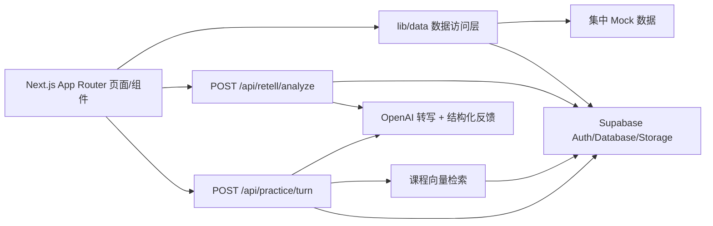

# 架构

## 分层

- `app/`：路由与服务端入口（`loading`/`error`/`not-found` 全局收口）。
- `components/`：展示与交互，不直接散落 Supabase/OpenAI 查询。
- `lib/data/`：repository 层，云端读 Supabase、演示读 Mock，snake_case→camelCase 显式映射。
- `lib/openai/`：`server-only` 服务端模块（client/transcribe/feedback/embedding）。
- `lib/agent/`：情景 Agent、结构化输出校验、RAG 检索、报告与同步鉴权。
- `lib/supabase/`：browser/server/proxy 三客户端 + `isSupabaseConfigured` 演示开关。
- `supabase/migrations/`：`001` 建表 + RLS + 私有 bucket，`002` 补反馈字段。

## 关键决策

- 同源 Route Handler 做 AI 分析，`OPENAI_API_KEY` 不出服务端。
- `/api/practice/turn` 将课程检索片段、薄弱表达、对话历史和本轮回答组合为受 JSON Schema 约束的 Agent 输入。
- `/api/admin/rag-sync` 使用独立 Bearer secret，只回填缺失向量且可安全重复执行。
- 状态机 `uploaded → transcribing → analyzing → completed/failed`，失败复用同一行重试。
- 缺变量自动演示模式，保证可构建、可浏览。
